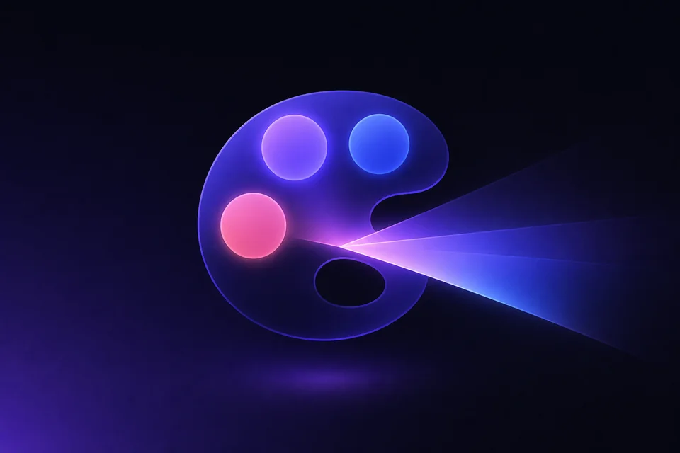
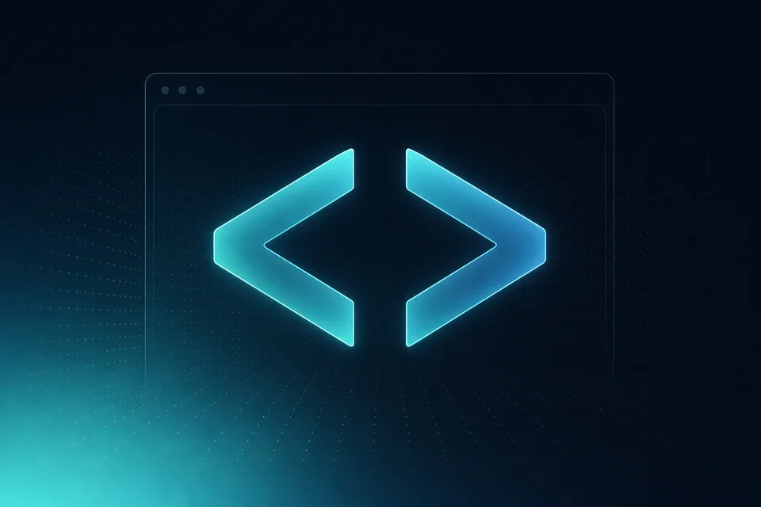
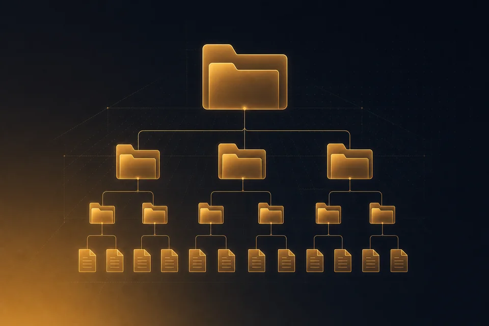

<div align="center">

# IndieArk Skills

**IndieArk 的八个 AI Skill，装进 Codex、Claude Code、Cursor 就能用。**

`图` · `片` · `网` · `视` · `搜` · `办` · `构` · `写` — 一个字对应一个 Skill。

[](#license)
[](#开发栈)
[](#启动)
[](#核心能力)
[](#核心能力)
[](#什么是-skill)

[核心能力](#核心能力) · [启动](#启动) · [使用流程](#使用流程) · [配置](#配置) · [目录结构](#目录结构) · [协同关系](#协同关系)

</div>

---

> 让 AI 出图、做 PPT、写网页、拍视频，以前每次都要重新交代工具和步骤。这里把常用的八件事各做成一个 Skill，装好后 agent 会按需加载。

---

## 核心能力

前四个已经能用，处于 `beta`、`router-alpha`、`alpha` 阶段，还没正式发布。后四个是 `preview`，agent 能加载，命令行和下游工具还没接好。

<table>
<tr>
<td width="25%" align="center" valign="top">
  <a href="#image-gen-pro"></a>
  <p><a href="#image-gen-pro"><b>image-gen-pro</b></a> · <code>图</code></p>
</td>
<td width="25%" align="center" valign="top">
  <a href="#ppt-gen-pro"></a>
  <p><a href="#ppt-gen-pro"><b>ppt-gen-pro</b></a> · <code>片</code></p>
</td>
<td width="25%" align="center" valign="top">
  <a href="#html-gen-pro"></a>
  <p><a href="#html-gen-pro"><b>html-gen-pro</b></a> · <code>网</code></p>
</td>
<td width="25%" align="center" valign="top">
  <a href="#video-gen-pro"></a>
  <p><a href="#video-gen-pro"><b>video-gen-pro</b></a> · <code>视</code></p>
</td>
</tr>
<tr>
<td width="25%" align="center" valign="top">
  <a href="#search-pro"></a>
  <p><a href="#search-pro"><b>search-pro</b></a> · <code>搜</code></p>
</td>
<td width="25%" align="center" valign="top">
  <a href="#office-pro"></a>
  <p><a href="#office-pro"><b>office-pro</b></a> · <code>办</code></p>
</td>
<td width="25%" align="center" valign="top">
  <a href="#struct-pro"></a>
  <p><a href="#struct-pro"><b>struct-pro</b></a> · <code>构</code></p>
</td>
<td width="25%" align="center" valign="top">
  <a href="#write-pro"></a>
  <p><a href="#write-pro"><b>write-pro</b></a> · <code>写</code></p>
</td>
</tr>
</table>

| Skill | 状态 · 版本 | 做什么 |
|---|---|---|
| [image-gen-pro](./image-gen-pro/SKILL.md) | `beta` · `0.1.0-beta.29` | 出图、改图、透明 PNG、批量，命令行 `imagen` |
| [ppt-gen-pro](./ppt-gen-pro/SKILL.md) | `router-alpha` · `0.1.0` | 定 PPT 大纲和风格，渲染交给外部工具 |
| [html-gen-pro](./html-gen-pro/SKILL.md) | `router-alpha` · `0.2.0` | 定网页方向和视觉检查，渲染交给外部工具 |
| [video-gen-pro](./video-gen-pro/SKILL.md) | `alpha` · `0.5.0` | 拆镜头、写提示词、调 Seedance 2.0 出视频，命令行 `videogen` / `seedance2` |
| [search-pro](./search-pro/SKILL.md) | `preview` · `0.1.0-skeleton` | 搜网页、抓页面、下载音视频、转格式 |
| [office-pro](./office-pro/SKILL.md) | `preview` · `0.1.0-skeleton` | 飞书操作和数据分析 |
| [struct-pro](./struct-pro/SKILL.md) | `preview` · `0.1.0-skeleton` | 整理文件夹、代码结构和文档结构 |
| [write-pro](./write-pro/SKILL.md) | `preview` · `0.1.0-skeleton` | 长文、短文、商业文案、技术文档 |

版本和状态以 [manifest.json](./manifest.json) 为准。

---

## 启动

这是一组 Skill，不是服务，没有端口。目前主要面向 Windows 和 PowerShell。

### 安装

```powershell
git clone https://github.com/indieark/indieark-skills.git
cd indieark-skills
.\install.ps1                  # 只装 Skill
.\install.ps1 -InstallCli      # 同时装命令行入口
```

[install.ps1](./install.ps1) 会把 [manifest.json](./manifest.json) 里的 15 个 Skill 装进去（八件套加 `video-gen-pro` 的 7 个子 Skill）。加 `-InstallCli` 会多装 `imagen`、`videogen`、`seedance2` 三个命令。

| 装什么 | 默认装到 |
|---|---|
| Skill | `$env:USERPROFILE\.codex\skills\<name>\` |
| 命令行入口 | `$env:LOCALAPPDATA\Microsoft\WindowsApps\<name>.cmd` |

### 手动复制

其他平台或其他 agent，直接复制文件夹：

```powershell
Copy-Item -Recurse .\image-gen-pro $env:USERPROFILE\.codex\skills\   # Codex CLI
Copy-Item -Recurse .\image-gen-pro .\.claude\skills\                 # Claude Code
Copy-Item -Recurse .\image-gen-pro .\.agents\skills\                 # Cursor / 通用
```

### Git Submodule

```powershell
git submodule add https://github.com/indieark/indieark-skills.git vendor/indieark-skills
New-Item -ItemType SymbolicLink -Path ".codex\skills\image-gen-pro" -Target "vendor/indieark-skills/image-gen-pro"
```

### 更新

```powershell
.\update.ps1                   # git pull --ff-only 后重装
.\update.ps1 -InstallCli       # 同时刷新命令行入口
```

### 兼容性

| Agent | Skill 放哪 | 状态 |
|---|---|---|
| **Codex CLI** | `$env:USERPROFILE\.codex\skills\<name>\` | ✅ 主要测试对象 |
| **Claude Code** | `.claude/skills/<name>/` 或 `~/.claude/skills/` | ✅ 手动复制可用 |
| **Cursor** | `.agents/skills/<name>/` | ✅ 手动复制可用 |
| **Claude.ai 网页版** | Settings → Capabilities → Skills | ✅ 上传 `.zip` |

只要 agent 支持 Agent Skills 规范，把文件夹放进它扫描的目录就能识别。

---

## 使用流程

### 1 · 正常提需求

装好后不用记命令。直接说「做一张海报」「把这篇文章做成 PPT」，agent 会按每个 Skill 的 `description` 判断要不要加载。

### 2 · 各件分开用

八个 Skill 互不依赖，单装一个也能用。创作类四个（图、片、网、视）不互相调用，只是本地留痕目录的命名对齐：`_work/html_runs/`、`_work/image_gen_runs/`、`_work/seedance_upload/`。

### 3 · 写完接着做

只有 [write-pro](#write-pro) 会在写完后把活交给别的 Skill：

| 写完后要 | 交给 |
|---|---|
| 做 PPT | [ppt-gen-pro](#ppt-gen-pro) |
| 做网页 | [html-gen-pro](#html-gen-pro) |
| 发到飞书、Notion、公众号、邮件 | [office-pro](#office-pro) |
| 找资料、抓素材 | [search-pro](#search-pro) |

### 4 · 每件背后用的外部工具

| Skill | 调用的外部能力 |
|---|---|
| `image-gen-pro` | OpenAI image API / GPT Image 2 / 委托 Codex CLI |
| `video-gen-pro` | 火山方舟 Seedance 2.0 API，目前唯一的适配器 |
| `ppt-gen-pro` | 交给 `ppt-image-first`、`guizang-ppt-skill`、`ppt-master` 三个外部 Skill |
| `html-gen-pro` | 交给 `ui-ux-pro-max`、`taste-skill` 两个外部 Skill |
| `search-pro` | `smart-search-cli`、`scrapling`、`agent-browser`、`yt-dlp`、`pandoc`、`ffmpeg`、`imagemagick` |
| `office-pro` | 40 多个 `lark-*` Skill（飞书 OpenAPI） |
| `struct-pro` | 本地文件操作，默认只演练不动手 |
| `write-pro` | 9 个 `pro-*` 方法 Skill：`copy`、`exp`、`explain`、`idea`、`must`、`rule`、`struct`、`summary`、`test` |

---

## 每件的细节

### image-gen-pro · 图
<a id="image-gen-pro"></a>

`beta` · `0.1.0-beta.29` · 命令行 `imagen`

- 三种跑法：有 API key 直接调；没有就委托 Codex CLI；也能只演练不出图
- [references/](./image-gen-pro/references) 里有 18 类、80 多个模板：海报、UI、信息图、漫画等
- 图生图、编辑、透明 PNG、按清单批量出图，都用同一个命令行

[SKILL.md](./image-gen-pro/SKILL.md) · [README](./image-gen-pro/README.md)

### ppt-gen-pro · 片
<a id="ppt-gen-pro"></a>

`router-alpha` · `0.1.0`

- 本仓库只负责判断受众、平台、风格，排大纲和故事板；渲染交给外部 Skill
- 已接三个外部 Skill：[`ppt-image-first`](https://github.com/NyxTides/ppt-image-first)、[`guizang-ppt-skill`](https://github.com/op7418/guizang-ppt-skill)、[`ppt-master`](https://github.com/hugohe3/ppt-master)
- 不自带 PPT 渲染器，也不打包外部代码，需要时 `git clone` 到本地 `extensions/`，不进仓库

[SKILL.md](./ppt-gen-pro/SKILL.md) · [路由表](./ppt-gen-pro/references/router.md)

### html-gen-pro · 网
<a id="html-gen-pro"></a>

`router-alpha` · `0.2.0`

- 本仓库负责判断做什么页面、从五个方面检查视觉、避免 AI 套路页面；渲染交给外部 Skill
- 已接两个外部 Skill：[`ui-ux-pro-max`](https://github.com/nextlevelbuilder/ui-ux-pro-max-skill)（落地页、应用页、风格稿）、[`taste-skill`](https://github.com/Leonxlnx/taste-skill)（风格稿，含 brutalist、soft 子 Skill）
- 不做 PPT、不做单纯的 UI 审查、不做后端或 CLI、不回答纯方法问题

[SKILL.md](./html-gen-pro/SKILL.md) · [README](./html-gen-pro/README.md)

### video-gen-pro · 视
<a id="video-gen-pro"></a>

`alpha` · `0.5.0` · 命令行 `videogen`（别名 `seedance2`）

- 导演流程：用自然语言拆镜头，生成场景卡，规划多段连续性，用上一段的尾帧接下一段
- 目前只接了火山方舟 Seedance 2.0（`doubao-seedance-2-0-260128` 和 `*-fast`）
- 从 0.5.0 起拆成 8 个 Skill：主 Skill [video-gen-pro](./video-gen-pro/SKILL.md) 负责调度和执行，命令行都在这里；另有 [script](./video-gen-script/SKILL.md)、[guide](./video-gen-guide/SKILL.md)、[advisor](./video-gen-advisor/SKILL.md)、[director](./video-gen-director/SKILL.md)、[storyboard](./video-gen-storyboard/SKILL.md)、[assets](./video-gen-assets/SKILL.md)、[cinematography](./video-gen-cinematography/SKILL.md) 七个子 Skill，装好后放在同一层，按需要互相指路

[SKILL.md](./video-gen-pro/SKILL.md) · [README](./video-gen-pro/README.md) · [CHANGELOG](./video-gen-pro/CHANGELOG.md)

### search-pro · 搜
<a id="search-pro"></a>

`preview` · `0.1.0-skeleton`

- 五条路线：搜网页、抓静态页、抓要渲染的页、下载音视频、转格式
- 按目标能不能访问、要不要跑 JS、要不要登录来挑工具

[SKILL.md](./search-pro/SKILL.md) · [路由表](./search-pro/references/router.md)

### office-pro · 办
<a id="office-pro"></a>

`preview` · `0.1.0-skeleton`

- 两条路线：`office-connect`（先接飞书）和 `data-analysis`（探索、清洗、统计、作图、出报告）
- 调用 `lark-*` Skill，不复制飞书 OpenAPI 文档
- 凭据放本机环境变量，不进仓库

[SKILL.md](./office-pro/SKILL.md) · [路由表](./office-pro/references/router.md)

### struct-pro · 构
<a id="struct-pro"></a>

`preview` · `0.1.0-skeleton`

- 三条路线：`folder-tidy`、`code-structure`、`doc-structure`
- 默认只演练；会删改的操作要明确打开；跨仓库移动文件已禁止
- 文档按三类读者分：AI 记忆、AI 阅读、人阅读

[SKILL.md](./struct-pro/SKILL.md) · [路由表](./struct-pro/references/router.md)

### write-pro · 写
<a id="write-pro"></a>

`preview` · `0.1.0-skeleton`

- 四条路线：长文、短文、商业文案、技术文档
- 定稿前必须列出至少 3 条别人替换不了的特点，避免写成 AI 默认腔
- 优先用个人风格提示词

[SKILL.md](./write-pro/SKILL.md) · [路由表](./write-pro/references/router.md)

---

## 配置

没有环境变量要配，脚本参数如下：

| 参数 | 默认 | 说明 |
|---|---|---|
| `-TargetDir` | `$env:USERPROFILE\.codex\skills` | Skill 装到哪，[install.ps1](./install.ps1) 和 [update.ps1](./update.ps1) 都有 |
| `-InstallCli` | 关 | 同时装命令行入口 |
| `-BinDir` | `$env:LOCALAPPDATA\Microsoft\WindowsApps` | 命令行入口 `.cmd` 放哪 |
| `-PythonCommand` | `python` | 命令行入口用哪个 Python 启动 |
| `-SkipPull` | 关 | [update.ps1](./update.ps1) 跳过 `git pull`，只重装 |
| `-WhatIf` | 关 | [install.ps1](./install.ps1) 和 [publish.ps1](./publish.ps1) 只演练，不写文件 |

**说明**：

- API key 等凭据放在本机，不写进仓库；每个 Skill 要哪些变量，看它自己的 `SKILL.md` 或 README

---

## 开发栈

| 用途 | 用的什么 |
|---|---|
| **Skill 本体** | Markdown（`SKILL.md` + `references/`）+ `skill.json` |
| **命令行** | Python 脚本，`imagen`、`videogen`、`seedance2` |
| **安装和发布** | Windows PowerShell 5.1：[install.ps1](./install.ps1)、[update.ps1](./update.ps1)、[publish.ps1](./publish.ps1) |
| **分发清单** | [manifest.json](./manifest.json) |

---

## 目录结构

```text
indieark-skills/
├─ manifest.json              # 发布的 Skill 清单、版本、状态、命令行入口
├─ install.ps1                # 安装
├─ update.ps1                 # 拉取后重装
├─ publish.ps1                # 从源仓刷新本仓库（维护者用）
├─ assets/skills/             # 八张封面图
├─ image-gen-pro/             # 每个 Skill 一个文件夹：SKILL.md、skill.json、references/、scripts/
├─ ppt-gen-pro/
├─ html-gen-pro/
├─ video-gen-pro/             # 视频主 Skill，命令行在这里
├─ video-gen-*/               # 7 个视频子 Skill
├─ search-pro/
├─ office-pro/
├─ struct-pro/
└─ write-pro/
```

---

## 什么是 Skill

Skill 是 agent 按需加载的一个文件夹：

```text
<skill-name>/
├─ SKILL.md      # 必需：什么时候用、怎么用（YAML frontmatter + 指令）
├─ README.md     # 给人看的说明
├─ skill.json    # 版本、命令行、路由
├─ references/   # 可选：agent 按需读的扩展文档
├─ scripts/      # 可选：可执行脚本
└─ assets/       # 可选：模板、字体、图片
```

agent 加不加载某个 Skill，看 frontmatter 里的 `description`。完整规范见 [agentskills.io](https://agentskills.io) 和 [`anthropics/skills`](https://github.com/anthropics/skills)。

---

## 发布

本仓库是发布副本。每个 Skill 的能力、流程、命令行和模板，以各自的源仓为准，不在这里手改。

```powershell
.\publish.ps1 -SourceRoot ..\skills    # 从源仓刷新各 Skill 目录（会覆盖）
.\install.ps1 -WhatIf                  # 演练安装
git status --short ; git diff --stat
```

[publish.ps1](./publish.ps1) 默认从同级的 `skills` 目录读源仓。[manifest.json](./manifest.json) 的 `status` 和各 Skill 的 `skill.json` 保持一致：

| status | 意思 | 例子 |
|---|---|---|
| `beta` | 自带实现和命令行，还在改 | `image-gen-pro` |
| `router-alpha` | 只做判断和规划，渲染交给外部 Skill | `ppt-gen-pro`、`html-gen-pro` |
| `alpha` | 自带第一个适配器，以后接更多服务商 | `video-gen-pro` 及 7 个子 Skill |
| `preview` | `0.1.0-skeleton`，能加载，命令行和下游还没接 | `search-pro`、`office-pro`、`struct-pro`、`write-pro` |

---

## 协同关系

八个 Skill 的源仓都不公开，这里只列公开的相关项目：

| 关联项目 | 关系 |
|---|---|
| [`anthropics/skills`](https://github.com/anthropics/skills) | Skill 文件夹格式的参考，本仓库按这个格式组织 |
| [`ui-ux-pro-max-skill`](https://github.com/nextlevelbuilder/ui-ux-pro-max-skill)、[`taste-skill`](https://github.com/Leonxlnx/taste-skill) | [html-gen-pro](#html-gen-pro) 把网页渲染交给它们 |
| [`ppt-image-first`](https://github.com/NyxTides/ppt-image-first)、[`guizang-ppt-skill`](https://github.com/op7418/guizang-ppt-skill)、[`ppt-master`](https://github.com/hugohe3/ppt-master) | [ppt-gen-pro](#ppt-gen-pro) 把 PPT 渲染交给它们 |

---

## License

Proprietary © IndieArk（仓库里没有单独的 LICENSE 文件）
